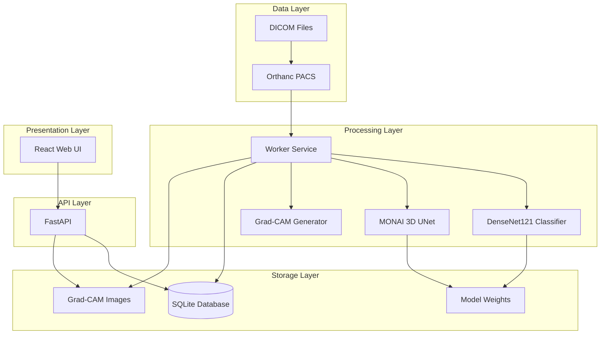

# System Architecture

## Components

### Orthanc
- DICOM PACS server for medical image storage
- Exposes REST API for study retrieval
- Port 8042 (HTTP), 4242 (DICOM)

### Worker Service
- Polls Orthanc for new studies
- Runs classification and segmentation inference
- Generates Grad-CAM heatmaps
- Stores results in SQLite

### API Service
- FastAPI backend serving study data
- Handles approve/reject decisions
- Maintains append-only audit log
- Port 8000

### Web UI
- React frontend for radiologist review
- Displays studies with heatmaps/segmentation
- Decision workflow integration
- Port 3000
